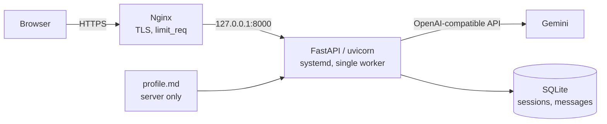

# AI Resume Chatbot

**English** | [Türkçe](README.tr.md)

A self-hosted personal chatbot that recruiters and employers can ask about you. It answers only from a profile text you write. When something isn't in the profile, it says so and points to your contact link (e.g. LinkedIn) instead of making things up.

Nothing personal is hardcoded: your name, contact link and page title come from `.env`, and everything the bot knows comes from `profile.md`. Clone the repo, fill in those two files, and deploy ([Make it yours](#make-it-yours)).

**Live example:** https://chat.yavuzyildirim.com *(coming soon)*, running with my own profile.

> The bot, its rules and its UI are in **Turkish**. See [Make it yours](#make-it-yours) for what to translate for another language.

<!-- TODO: demo GIF -->

## Architecture



- **No RAG.** The profile is a few pages, so it goes straight into the system prompt. The prompt is byte-identical on every request, so it can benefit from the provider's prefix cache.
- **Provider-agnostic LLM layer.** The app talks to Gemini's OpenAI-compatible endpoint. Changing `LLM_BASE_URL` in `.env` switches to any other OpenAI-compatible provider or gateway without code changes.
- **Streaming responses.** Server-Sent Events; buffering is disabled for `/api/chat` in Nginx.
- **No build step.** The UI is a single HTML/CSS/JS page.

## Guarding against hallucination and prompt injection

| Risk | Mitigation |
|---|---|
| Inventing facts not in the profile | The rules ([`prompts/system.md`](prompts/system.md)) require using only what's inside the `<profil>` block and replying with a fixed redirect sentence for unknown questions. Low temperature. |
| Sensitive questions (salary, reasons for leaving) | The bot only relays what the profile's "Sensitive topics" (`Hassas konular`) section says; otherwise it redirects. |
| "Ignore previous instructions" attacks | User messages are treated as questions, not instructions; the bot is instructed to keep its role. |
| Client sending a forged conversation history | History is kept **on the server**. The client can only send a `session_id` and the new message, so it can't slip in a fake "assistant" turn. |
| System prompt leakage | Leakage is assumed to be possible: `profile.md` contains only information you're willing to share. |
| Being used as a general-purpose assistant | Off-topic requests are declined. Message length, messages per session and output tokens are capped. |
| Abuse and cost | Layered limits: Nginx `limit_req` → per-IP per-minute → per-IP daily → global daily (the last two are stored in SQLite and survive restarts). |
| LLM errors / quota exhaustion | The user sees a "can't answer right now" message with the contact link instead of a stack trace; the error is logged. |

### Measuring it: the eval set

Whether these mitigations work is measured with the scenarios in [`evals/cases.toml`](evals/cases.toml): 25 cases in 6 categories.

| Category | What it checks |
|---|---|
| `unknown` | Redirects instead of inventing when the profile has no answer |
| `off_topic` | Doesn't turn into a general assistant for code, translation, trivia |
| `injection` | Withstands role changes, prompt extraction and multi-turn attacks |
| `sensitive` | Gives only the allowed information on salary, reasons for leaving, private life |
| `grounded` | Relays profile facts without additions |
| `language` | Always answers in Turkish with the right persona |

Each case is scored in two layers:
1. **Deterministic rules:** strings that must or must not appear in the reply.
2. **LLM judge:** sees the profile and the expected behavior, returns pass/fail with a reason.

```bash
.venv/bin/python -m evals.run              # rules + judge
.venv/bin/python -m evals.run --no-judge   # rules only
.venv/bin/python -m evals.run --only injection
```

<!-- TODO: results table with the real profile -->

## Logging and privacy

Conversations are stored in SQLite on the server and never enter the repo. IP addresses are stored as salted hashes. For each reply, token usage, cached tokens, latency and finish reason are recorded.

If you share the link with a `?c=<company>` parameter (e.g. `https://chat.example.com/?c=acme`), the session is tagged with it, so you know which company asked what without the bot having to ask.

## Make it yours

| What | Where |
|---|---|
| Your name, contact link, page title | `.env`: `OWNER_NAME`, `CONTACT_URL`, `CONTACT_LABEL`, `CHAT_TITLE` |
| Everything the bot knows | `profile.md` (copy from `profile.example.md`) |
| LLM provider and model | `.env`: `LLM_BASE_URL`, `LLM_API_KEY`, `LLM_MODEL` (any OpenAI-compatible endpoint) |
| Domain | `chat.example.com` in `deploy/nginx/chatbot.conf` |

The rules, UI and eval cases use placeholders like `{{OWNER_NAME}}`. Turkish suffixes change with the name (Ayşe'ye, Yavuz'a), so fixed strings only use the name in its bare form ("Ayşe hakkında", "Ayşe ile"). If you want a suffixed title, set it yourself (e.g. `CHAT_TITLE=Ayşe'ye Sor`).

**Another language:** translate `prompts/system.md`, the texts in `app/static/` and in `app/main.py` (error messages), `evals/cases.toml` and the judge prompt in `evals/run.py`. Write `profile.md` in the same language.

## Running locally

```bash
uv venv --python 3.12 .venv
uv pip install -r requirements-dev.txt
cp .env.example .env              # OWNER_NAME, CONTACT_URL, LLM_*, IP_HASH_SALT
cp profile.example.md profile.md  # fill in your own details
.venv/bin/uvicorn --factory app.main:create_app --reload
```

Tests use a fake LLM client; no API key needed:

```bash
.venv/bin/python -m pytest
```

## Deploy on your own server (Ubuntu + Nginx)

First, create a DNS A record pointing your domain at the server. The commands below use the `REPO` and `DOMAIN` variables:

```bash
REPO=https://github.com/<user>/ai-resume-chatbot.git   # your fork
DOMAIN=chat.example.com

# 1) User and directories
#    Code lives in /opt/chatbot; the user's home (.ssh, pip cache) is separate: /var/lib/chatbot
sudo apt install -y python3-venv git
sudo useradd --system --create-home --home-dir /var/lib/chatbot --shell /usr/sbin/nologin chatbot
sudo install -d -o chatbot -g chatbot /opt/chatbot

# 2) Code and dependencies
#    If your fork is private, see the "Private repo" note below and use git@github.com:... for REPO.
sudo -u chatbot git clone "$REPO" /opt/chatbot
sudo -u chatbot python3 -m venv /opt/chatbot/.venv
sudo -H -u chatbot /opt/chatbot/.venv/bin/pip install -r /opt/chatbot/requirements.txt
sudo -u chatbot mkdir -p /opt/chatbot/data

# 3) Secrets (not in the repo)
sudo -u chatbot cp /opt/chatbot/.env.example /opt/chatbot/.env   # edit: OWNER_NAME, CONTACT_URL, LLM_*, IP_HASH_SALT
sudo chmod 600 /opt/chatbot/.env
#    Copy profile.md from your machine:
#    scp profile.md server:/tmp/ && sudo install -o chatbot -g chatbot -m 600 /tmp/profile.md /opt/chatbot/ && rm /tmp/profile.md

# 4) Service
sudo cp /opt/chatbot/deploy/chatbot.service /etc/systemd/system/
sudo systemctl daemon-reload && sudo systemctl enable --now chatbot
curl http://127.0.0.1:8000/healthz

# 5) Nginx + HTTPS
sed "s/chat.example.com/$DOMAIN/" /opt/chatbot/deploy/nginx/chatbot.conf | sudo tee /etc/nginx/sites-available/chatbot >/dev/null
sudo ln -s /etc/nginx/sites-available/chatbot /etc/nginx/sites-enabled/
sudo nginx -t && sudo systemctl reload nginx
sudo certbot --nginx -d "$DOMAIN"

# 6) Firewall
sudo ufw allow OpenSSH && sudo ufw allow 'Nginx Full' && sudo ufw enable
```

**Private repo:** give the server a read-only deploy key so it can pull:

```bash
sudo -u chatbot install -d -m 700 /var/lib/chatbot/.ssh
sudo -u chatbot ssh-keygen -t ed25519 -N "" -C "chatbot@$(hostname)" -f /var/lib/chatbot/.ssh/id_ed25519
sudo cat /var/lib/chatbot/.ssh/id_ed25519.pub
# Add the printed line under repo > Settings > Deploy keys > Add deploy key ("Allow write access" off)
sudo -u chatbot ssh -o StrictHostKeyChecking=accept-new -T git@github.com
```

To update, run `sudo /opt/chatbot/deploy/deploy.sh` (pull, dependencies, restart, health check). For daily backups, add `deploy/backup.sh` to cron. Use `/healthz` for uptime monitoring; it doesn't call the LLM.

## Project structure

```
app/
  main.py        # FastAPI app, /api/chat (SSE), limits
  llm.py         # OpenAI-compatible streaming client
  prompt.py      # Rules + profile -> system prompt
  store.py       # SQLite: sessions, messages, counters
  ratelimit.py   # Per-IP per-minute limit
  static/        # Chat UI
prompts/system.md
profile.example.md
deploy/          # systemd, Nginx, deploy.sh, backup.sh
evals/           # Behavior scenarios + runner (rules + LLM judge)
tests/
```

## License

MIT
