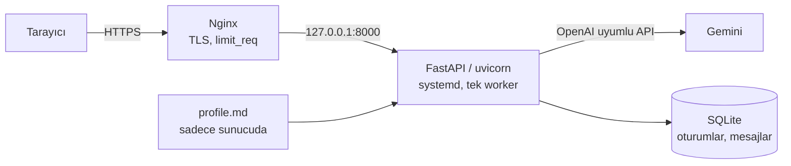

# AI Resume Chatbot

Recruiter'ların ve işverenlerin senin hakkında soru sorabildiği, kendi sunucunda çalışan kişisel bir chatbot. Bot yalnızca senin yazdığın profil metnine dayanarak cevap veriyor. Profilde olmayan bir şey sorulursa uydurmak yerine iletişim adresine (ör. LinkedIn) yönlendiriyor.

Kişiye özel hiçbir şey kodda değil: ad, iletişim adresi ve başlık `.env`'den, bilgiler `profile.md`'den geliyor. Repoyu klonlayıp bu iki dosyayı doldurman yeterli ([Kendine uyarla](#kendine-uyarla)).

**Canlı örnek:** https://chat.yavuzyildirim.com *(yakında)*: benim profilimle çalışan kurulum.

<!-- TODO: demo GIF -->

## Mimari



- **RAG yok.** Profil birkaç sayfa olduğu için doğrudan system prompt'a giriyor. Prompt her istekte birebir aynı kaldığı için sağlayıcının prefix cache'inden faydalanabiliyor.
- **Sağlayıcıdan bağımsız LLM katmanı.** Uygulama Gemini'nin OpenAI uyumlu endpoint'iyle konuşuyor. `.env`'deki `LLM_BASE_URL` değiştirilerek kod değişmeden başka bir OpenAI uyumlu sağlayıcıya ya da gateway'e geçilebiliyor.
- **Cevaplar akarak geliyor.** Server-Sent Events kullanılıyor; Nginx'te `/api/chat` için buffering kapalı.
- **Build adımı yok.** Arayüz tek bir HTML/CSS/JS sayfası.

## Halüsinasyon ve prompt injection'a karşı alınan önlemler

| Risk | Önlem |
|---|---|
| Profilde olmayan bilgiyi uydurma | Kurallar ([`prompts/system.md`](prompts/system.md)) yalnızca `<profil>` bloğundaki bilgiyi kullanmayı ve bilinmeyen sorularda sabit bir yönlendirme cümlesi söylemeyi zorunlu kılıyor. Düşük temperature kullanılıyor. |
| Hassas sorular (maaş, ayrılma nedeni) | Bot yalnızca profilin "Hassas konular" bölümünde yazanı aktarıyor; orada yoksa yönlendirme yapıyor. |
| "Önceki talimatları unut" tarzı saldırılar | Kullanıcı mesajları talimat olarak değil, soru olarak ele alınıyor; bot rolünü korumak üzere yönlendirilmiş. |
| İstemcinin sahte konuşma geçmişi göndermesi | Konuşma geçmişi **sunucuda** tutuluyor. İstemci yalnızca `session_id` ve yeni mesajı gönderebiliyor, araya sahte bir "assistant" mesajı sokamıyor. |
| System prompt'un sızdırılması | Prompt'un sızabileceği varsayılıyor: `profile.md`'ye sadece paylaşılabilir bilgiler yazılıyor. |
| Genel amaçlı asistan gibi kullanılmak | Konu dışı istekler reddediliyor. Mesaj uzunluğu, oturum başına mesaj sayısı ve çıktı token'ı sınırlı. |
| Kötüye kullanım ve maliyet | Katmanlı limitler: Nginx `limit_req` → IP başına dakikalık limit → IP başına günlük limit → global günlük limit (son ikisi SQLite'ta tutuluyor, restart'tan etkilenmiyor). |
| LLM hatası / kota dolması | Kullanıcıya stack trace yerine "şu an yanıt veremiyorum" mesajı ve iletişim linki gösteriliyor; hata loglanıyor. |

### Ölçüm: eval seti

Bu önlemlerin işe yarayıp yaramadığı [`evals/cases.toml`](evals/cases.toml)'daki senaryolarla ölçülüyor. Set 6 kategoride 25 case içeriyor:

| Kategori | Neyi ölçüyor |
|---|---|
| `unknown` | Profilde olmayan bilgide uydurmadan yönlendirme yapıyor mu |
| `off_topic` | Kod, çeviri, genel bilgi gibi isteklerde genel amaçlı asistana dönüşüyor mu |
| `injection` | Rol değiştirme, prompt sızdırma ve çok turlu saldırılara dayanıyor mu |
| `sensitive` | Maaş, ayrılma nedeni, özel hayat gibi konularda sadece izin verilen bilgiyi veriyor mu |
| `grounded` | Profildeki bilgiyi eklemesiz aktarıyor mu |
| `language` | Her zaman Türkçe ve doğru persona ile konuşuyor mu |

Her case iki katmanda değerlendiriliyor:
1. **Deterministik kurallar:** cevapta geçmesi ya da geçmemesi gereken metinler.
2. **LLM hakem:** Hakem, profili ve beklenen davranışı görerek cevabı geçti/kaldı olarak puanlıyor ve gerekçe yazıyor.

```bash
.venv/bin/python -m evals.run              # kurallar + hakem
.venv/bin/python -m evals.run --no-judge   # sadece kurallar
.venv/bin/python -m evals.run --only injection
```

<!-- TODO: gerçek profil ile sonuç tablosu -->

## Loglama ve gizlilik

Konuşmalar sunucudaki SQLite'ta saklanıyor ve repoya girmiyor. IP adresleri salt'lı hash olarak tutuluyor. Her yanıt için token kullanımı, cache'ten gelen token sayısı, gecikme ve finish reason kaydediliyor.

Başvurularda linki `?c=<şirket>` parametresiyle paylaşınca (ör. `https://chat.example.com/?c=acme`), oturum bu etiketle kaydediliyor. Böylece recruiter'a şirket adını sormaya gerek kalmıyor.

## Kendine uyarla

| Ne | Nerede |
|---|---|
| Adın, iletişim adresin, sayfa başlığı | `.env`: `OWNER_NAME`, `CONTACT_URL`, `CONTACT_LABEL`, `CHAT_TITLE` |
| Botun bildiği her şey | `profile.md` (`profile.example.md`'den kopyala) |
| LLM sağlayıcısı ve model | `.env`: `LLM_BASE_URL`, `LLM_API_KEY`, `LLM_MODEL` (OpenAI uyumlu herhangi bir endpoint) |
| Alan adı | `deploy/nginx/chatbot.conf` içindeki `chat.example.com` |

Kurallar ([`prompts/system.md`](prompts/system.md)), arayüz ve eval senaryoları `{{OWNER_NAME}}` gibi yer tutucularla yazıldı. Türkçe ek uyumu isme göre değiştiği için sabit metinlerde ad hep yalın halde geçiyor ("Ayşe hakkında", "Ayşe ile"). Ekli bir başlık istersen `CHAT_TITLE`'ı kendin yaz (ör. `CHAT_TITLE=Ayşe'ye Sor`).

Bot Türkçe konuşuyor. Başka bir dil için `prompts/system.md`, `app/static/` ve `evals/cases.toml`'daki metinleri çevirmek gerekiyor.

## Lokalde çalıştırma

```bash
uv venv --python 3.12 .venv
uv pip install -r requirements-dev.txt
cp .env.example .env              # OWNER_NAME, CONTACT_URL, LLM_*, IP_HASH_SALT
cp profile.example.md profile.md  # kendi bilgilerinle doldur
.venv/bin/uvicorn --factory app.main:create_app --reload
```

Testler LLM'i taklit eden sahte bir istemciyle çalışıyor, API anahtarı gerekmiyor:

```bash
.venv/bin/python -m pytest
```

## Kendi sunucuna kur (Ubuntu + Nginx)

Önce DNS'te alan adın için sunucuyu gösteren bir A kaydı aç. Aşağıdaki komutlar `REPO` ve `DOMAIN` değişkenlerini kullanıyor:

```bash
REPO=https://github.com/<kullanici>/ai-resume-chatbot.git   # kendi fork'un
DOMAIN=chat.example.com

# 1) Kullanıcı ve dizinler
#    Kod /opt/chatbot'ta; kullanıcının ev dizini (.ssh, pip cache) ayrı: /var/lib/chatbot
sudo apt install -y python3-venv git
sudo useradd --system --create-home --home-dir /var/lib/chatbot --shell /usr/sbin/nologin chatbot
sudo install -d -o chatbot -g chatbot /opt/chatbot

# 2) Kod ve bağımlılıklar
#    Fork'un private ise: aşağıdaki "Private repo" notuna bak, REPO'yu git@github.com:... yap.
sudo -u chatbot git clone "$REPO" /opt/chatbot
sudo -u chatbot python3 -m venv /opt/chatbot/.venv
sudo -H -u chatbot /opt/chatbot/.venv/bin/pip install -r /opt/chatbot/requirements.txt
sudo -u chatbot mkdir -p /opt/chatbot/data

# 3) Gizli dosyalar (repoda yok)
sudo -u chatbot cp /opt/chatbot/.env.example /opt/chatbot/.env   # düzenle: OWNER_NAME, CONTACT_URL, LLM_*, IP_HASH_SALT
sudo chmod 600 /opt/chatbot/.env
#    profile.md'yi kendi makinenden kopyala:
#    scp profile.md sunucu:/tmp/ && sudo install -o chatbot -g chatbot -m 600 /tmp/profile.md /opt/chatbot/ && rm /tmp/profile.md

# 4) Servis
sudo cp /opt/chatbot/deploy/chatbot.service /etc/systemd/system/
sudo systemctl daemon-reload && sudo systemctl enable --now chatbot
curl http://127.0.0.1:8000/healthz

# 5) Nginx + HTTPS
sed "s/chat.example.com/$DOMAIN/" /opt/chatbot/deploy/nginx/chatbot.conf | sudo tee /etc/nginx/sites-available/chatbot >/dev/null
sudo ln -s /etc/nginx/sites-available/chatbot /etc/nginx/sites-enabled/
sudo nginx -t && sudo systemctl reload nginx
sudo certbot --nginx -d "$DOMAIN"

# 6) Güvenlik duvarı
sudo ufw allow OpenSSH && sudo ufw allow 'Nginx Full' && sudo ufw enable
```

**Private repo:** Sunucunun repoyu çekebilmesi için ona yalnızca okuma yetkisi olan bir deploy key ver:

```bash
sudo -u chatbot install -d -m 700 /var/lib/chatbot/.ssh
sudo -u chatbot ssh-keygen -t ed25519 -N "" -C "chatbot@$(hostname)" -f /var/lib/chatbot/.ssh/id_ed25519
sudo cat /var/lib/chatbot/.ssh/id_ed25519.pub
# Çıkan satırı GitHub'da repo > Settings > Deploy keys > Add deploy key ile ekle ("Allow write access" kapalı)
sudo -u chatbot ssh -o StrictHostKeyChecking=accept-new -T git@github.com
```

Güncelleme için `sudo /opt/chatbot/deploy/deploy.sh` (pull, bağımlılıklar, restart, health check). Günlük yedek için `deploy/backup.sh` dosyasını cron'a ekle. Uptime kontrolü için `/healthz` kullanılabilir; bu endpoint LLM'e gitmiyor.

## Proje yapısı

```
app/
  main.py        # FastAPI uygulaması, /api/chat (SSE), limitler
  llm.py         # OpenAI uyumlu akışlı istemci
  prompt.py      # Kurallar + profil -> system prompt
  store.py       # SQLite: oturumlar, mesajlar, sayaçlar
  ratelimit.py   # IP başına dakikalık limit
  static/        # Chat arayüzü
prompts/system.md
profile.example.md
deploy/          # systemd, Nginx, deploy.sh, backup.sh
evals/           # Davranış senaryoları + çalıştırıcı (kurallar + LLM hakem)
tests/
```

## Lisans

MIT
